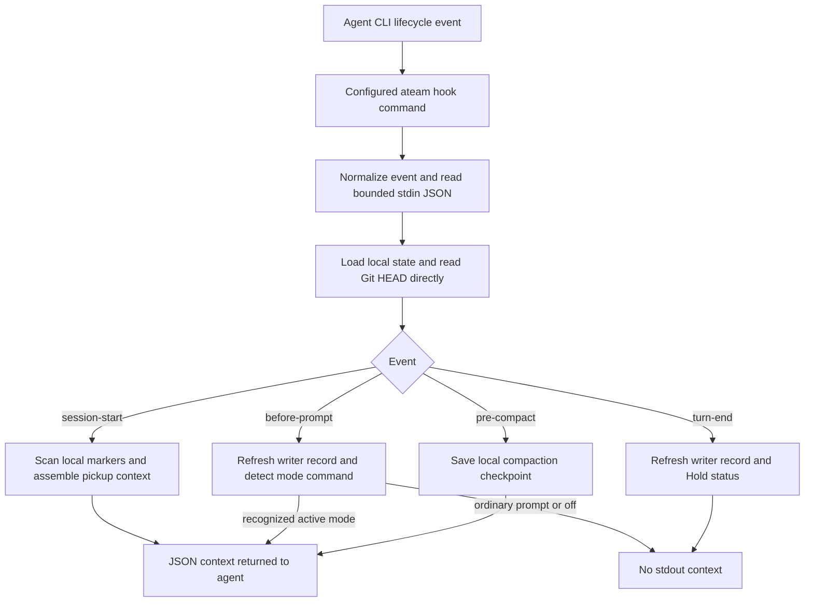

# How the harness runs

ATeam combines written instructions, automatic lifecycle hooks, and tools the agent must explicitly call. These are different mechanisms. A hook can put advice into context or save local state; it does not make the model obey that advice. This guide describes the current implementation, not a guarantee that every installed agent version invokes every configured event.

## From an agent event to context

`ateam init` writes the configuration that connects each agent's events to `ateam hook --event … --agent …`. The [platform mapping](../.agents/README.md#how-each-cli-reads-this-repository) lists the native event names. The CLI starts a short-lived Go process for each invocation; the hook is not a persistent coordinator.

The explicit `--event` takes precedence over the payload's `hook_event_name` or `event` (`SessionStart`, `UserPromptSubmit`/`BeforeAgent`/`PreInvocation`, `PreCompact`/`PreCompress`, and `Stop`/`AfterAgent`/`SessionEnd`/`PostInvocation`). The working directory determines the repository root; the payload's `cwd` field is parsed but does not redirect the hook. Input reading is capped at 1 MiB, and session identity reads `session_id` with `conversationId` (used by Antigravity `agy`) as a fallback. The handler loads `.ateam/state.json` and reads Git HEAD without launching Git. Missing state starts with mode `full`.

## What each event actually does

| Event | Reads and work | Persistent changes | Context returned |
| --- | --- | --- | --- |
| `session-start` | Loads cached state/writer information, reads HEAD, scans shortcuts, Holds, and the OpenSpec queue. | None from this handler; the refreshed view is assembled in memory. | Pickup summary: mode, forge, branch/HEAD, build/sync metadata, cached dirty status, markers, relevant writer warning, recent cached decisions, and last handoff (or `STALE — handoff omitted` when HEAD drifted, the branch changed, or the referenced PR closed/merged). Adds the Ponytail ladder unless mode is `off`. |
| `before-prompt` | Reads `prompt` or `user_prompt`, looking for a mode command. | Refreshes `.ateam/writer.json`. A recognized command also saves the mode in `.ateam/state.json`. | Ladder for a recognized non-off mode command. Ordinary prompts and switches to `off` produce no context (`{}` for `--agent agy`). |
| `pre-compact` | Reads HEAD and rescans shortcuts and Holds. | Updates those state fields. Preserves an existing handoff only when it belongs to the same active session (`SessionID`) and is not stale; otherwise creates a fresh session checkpoint. | Five-field checkpoint text. Does not post to a forge. |
| `turn-end` | Refreshes the writer record and scans Holds. | Saves Hold results or their scan error in state. | None for Claude/Codex/Gemini (`{"decision":"allow"}` for `--agent agy`). Does not clear the writer record or perform an explicit handoff. |

For Claude Code, Codex CLI, and Gemini CLI (`--agent claude|codex|gemini`), context appears both as top-level `additionalContext` and in `hookSpecificOutput.additionalContext` (`SessionStart`, `UserPromptSubmit`, or `PreCompact`), and silent paths write no JSON at all. For Antigravity (`--agent agy` or `antigravity`), whose hook unmarshaler uses strict `protojson`, context is emitted as `{"injectSteps":[{"systemMessage":{"systemMessage":"..."}}]}` (omitting `additionalContext` and `hookSpecificOutput`), a no-op `PreInvocation` emits `{}`, and `turn-end` (`Stop`) emits `{"decision":"allow"}`. Antigravity's `.agents/hooks.json` exposes `SessionStart`, `PreInvocation`, and `Stop`; it does not expose a `PreCompact` event and `PreInvocation` stdin omits raw user prompt text (tracked via `// shortcut:`), so Ponytail mode switches in `agy` use `ateam state mode <level>` or `/ponytail`.

To fire `pre-compact` checkpoints before long-context attention drift on 1M-token models, `ateam init` also scaffolds ~500k token auto-compaction defaults in client configs that support them: `.claude/settings.json` (`"autoCompactWindow": 500000`), `.codex/config.toml` (`model_context_window = 500000` and `model_auto_compact_token_limit = 450000`), and `.gemini/settings.json` (`"model": {"chatCompression": {"contextPercentageThreshold": 0.5}}`). Antigravity (`agy`) does not expose a configurable compaction threshold key in `settings.json` and uses built-in checkpointing plus manual `/compact`, `/context`, `/btw`, and subagents.

## The opinions behind the design

| Choice | Why this harness chooses it | Tradeoff / limit |
| --- | --- | --- |
| One canonical instruction/skill set | Reduce drift between agents. | Generated adapters and local parity checks do not prove live CLI compatibility. Existing files are not automatically migrated by `init`. |
| Compact guidance at session start and mode commands | Put the decision ladder in context without repeating it on every prompt. | The agent may forget or ignore it. Repeating a mode command injects it again even if the mode is unchanged. |
| ~500k context/auto-compaction defaults | Keep 1M-token models within the 400k–600k range where attention stays sharp and trigger `PreCompact`/`PreCompress` early. | Preserved client config files are not overwritten by `init`; `agy` has no configurable compaction threshold key, and Gemini's percentage scales with model window size. |
| Local reads and Go-only hook execution | Avoid subprocess and network latency in the prompt path. | The snapshot mixes live HEAD/marker data with cached fields. Dirty status, worktrees, forge cards, and previous handoff details can be stale. Filesystem scans still cost time as repositories grow. |
| Preserve an explicit owned handoff during compaction | Keep the human/agent-authored goal and constraints for the current session instead of replacing them with generic text, while replacing stale or foreign handoffs. | For a non-stale owned handoff, the existing semantic fields are preserved. Compaction is a safety net, not a complete handoff. |
| A writer record plus isolated worktrees | Surface possible concurrent editing and encourage explicit ownership. | The writer record is advisory, not an exclusive lock on editing. |
| Optional herdr adapter, gated on `HERDR_ENV=1` | Delegate what herdr already knows: the lease records `HERDR_PANE_ID`/`HERDR_WORKSPACE_ID`, `herdr worktree create` is a claim convenience, and the plugin (`.agents/herdr/herdr-plugin.toml`) runs `ateam state herdr on-event` to toast new `HALT`/`RED`/`BLOCKED` queue caveats and Holds. | Hooks, `.ateam/` state, Holds, and `git worktree list` stay local and authoritative; the hook only reads env. Toasts arrive at the end of a turn, only while herdr runs the plugin, and need `ateam` on herdr's PATH. Link with `herdr plugin link "$PWD/.agents/herdr"`. |
| OpenSpec tasks, inline Holds, and shortcut comments | Keep blockers and deferred work close to the repository's actual work. | Scans depend on recognized syntax and supported source extensions; see [adoption limits](adoption.md). |
| Taskfile verification and mutation evidence | Make checks repeatable and show that a test can catch a plausible defect. | Hooks do not run these checks. The agent, user, or CI must invoke them; the mutation runner is Go-only. |

The sub-10ms hook budget is a design target. `ateam doctor` currently fails its timing check above 25ms; its measured value is not a performance guarantee for every checkout.

## Modes and writer ownership

`/ponytail lite|full|ultra|off` and `/mode lite|full|ultra|off` are recognized case-insensitively in prompt text. The entire trimmed prompt `stop ponytail` or `normal mode` also selects `off`. This is pattern matching, not a structured command parser: matching text embedded in a longer prompt can change the mode. Ordinary prompts leave the saved mode unchanged.

- `lite`: build what was asked and name the smaller option.
- `full` (default): smallest complete change; no unrequested features or wrappers.
- `ultra`: question requirements not justified by the need before building.
- `off`: suppress ladder injection. Pickup context, writer updates, Hold scans, and compaction bookkeeping still run. Written `AGENTS.md` rules also remain in effect.

Mode is stored per checkout's local state, not privately per session. It can also be changed through the state CLI, MCP, or board; those changes do not themselves inject a new prompt into an already-running agent. Modes do not select a model or adjust provider settings.

The writer record contains agent, session ID (`session_id` or Antigravity `conversationId`), PID, and last-seen time. Identity comes from `--agent`, then `ATEAM_AGENT`, then an agent-prefixed branch, then the generic `agent` fallback. `WriteWriterLease` records the parent client PID (`os.Getppid()` when valid) rather than only the short-lived hook process PID, and `BuildPickupSummary` checks OS process liveness (`IsProcessAlive`) so dead PIDs are labeled `(exited)` without raising a competing-writer warning. Inside herdr (`HERDR_ENV=1`) the record also stores the herdr pane and workspace IDs, and pickup lines name the pane; a stray `HERDR_PANE_ID` without `HERDR_ENV=1` is ignored.

Pickup warns when a different nonempty session ID with a live PID was seen within ten minutes. It does not acquire exclusive edit ownership. `before-prompt` and `turn-end` replace the record; the latter deliberately keeps evidence of recent activity. Explicit handoff attempts to clear it. Separate worktrees and agent cooperation remain necessary.

## Automatic work versus explicit work

The [shared protocol](../.agents/protocol.md) asks agents to clarify, claim, verify, and hand off. Its rules are instructions unless backed by a specific tool or CI check:

- Hooks do not create issues, branches, worktrees, PRs, or OpenSpec proposals.
- Hooks do not run formatters, unit tests, `task verify`, mutation checks, or forge synchronization.
- Hooks do not enforce the decision ladder, prevent edits by another session, or approve/merge a PR. The hook output type has decision fields, but these handlers do not set a blocking decision.
- Explicit `ateam state pickup` and MCP `pickup` / `board` refresh repository state more broadly than the startup hook and attempt a bounded (3s) best-effort forge sync when stale (falling back to cached cards with a warning on failure); `ateam state sync` performs an explicit forge synchronization. MCP is not automatically invoked by the hooks.
- Explicit `ateam state handoff` records the supplied Goal, Addresses, Constraints, Done when, and Checks to run using a refreshed Git snapshot. It attempts to clear the writer record and normally attempts a PR comment when a forge is configured. Use `--no-post` for local-only handoff. A forge-post failure is reported on stderr but does not undo the local checkpoint.

A successful hook invocation therefore does not mean a delivery gate passed. Use the project's actual verification commands and review its results.

## Failure behavior and troubleshooting

Unknown event names are silent no-ops. Malformed or unreadable stdin is not returned as a parsing error; an explicit recognized event can still run with empty/default payload fields. An unreadable or malformed state cache does return an error. The CLI reports handler errors to stderr and exits 1; the host agent controls what that means for its lifecycle.

Startup Hold/OpenSpec scan errors appear as an unavailable-status warning rather than a reassuring zero count. At compaction, returned marker-scan errors stop the handler; at turn end, a Hold scan error is stored. Writer-record write errors are ignored by the hook caller, so a successful exit does not prove the record was saved. Some scanners also skip unreadable files: no returned error is not proof that every file was scanned.

When behavior seems surprising:

1. Confirm the configured command, executable on PATH, and working directory. Compare the [event mapping](../.agents/README.md#how-each-cli-reads-this-repository) with the installed agent's actual events.
2. Inspect stdout, stderr, and exit status separately. No context on an ordinary prompt or turn end is expected.
3. Inspect `.ateam/state.json` and `.ateam/writer.json`. Use explicit pickup to refresh broader state; do not interpret cached dirty status or a lease timestamp as live truth.
4. Run `ateam doctor --check` for local configuration parity, then verify actual hook invocation in the agent. A doctor pass alone cannot establish that integration.
5. Test state-changing events in a disposable checkout. Replaying `before-prompt`, `pre-compact`, or `turn-end` against your active checkout changes local state.

Implementation references: [hook handler](../internal/hook/hook.go), [CLI input/output and explicit handoff](../cmd/ateam/main.go), [state and writer handling](../internal/state/state.go), [generated wiring](../internal/bootstrap/templates.go), and [hook behavior tests](../internal/hook/hook_test.go).
